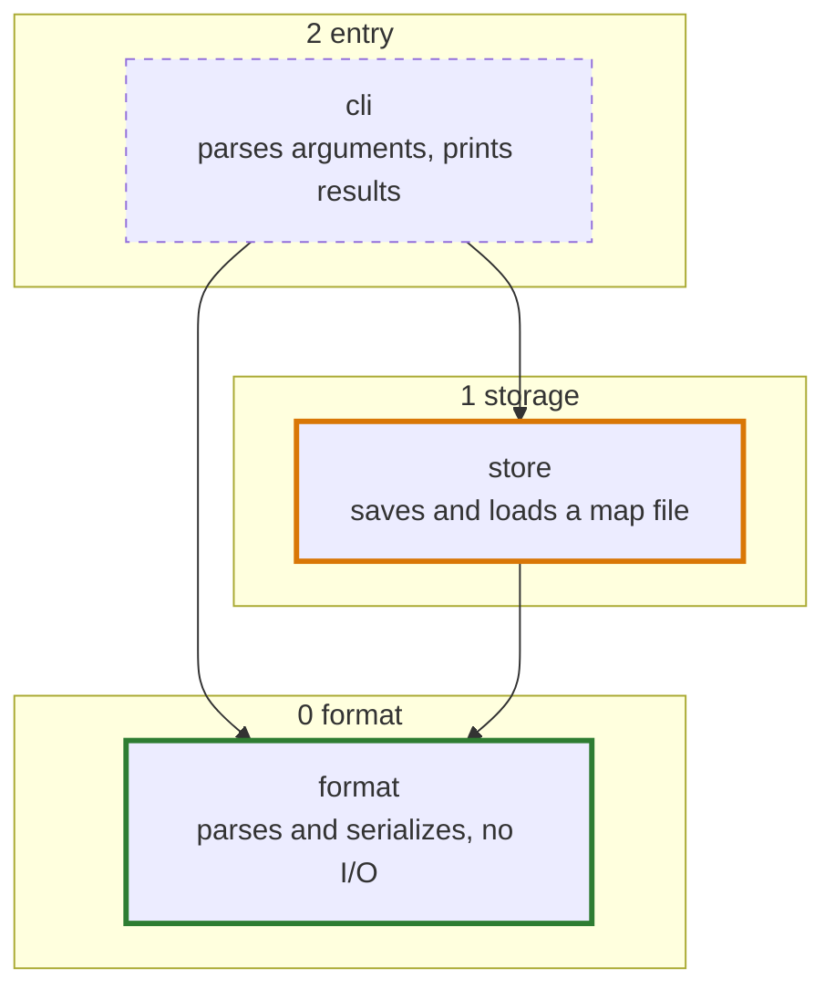

# Project Plan

Develop a shared understanding of what to build and how through lead-led
collaboration with the user, without pretending the whole route is already known.
Keep the full requested outcome visible while separating observed facts, candidate
approaches, accepted decisions and open questions.

## Establish the picture together

Start from the request and a bounded inspection of relevant code, documentation or
data. Then talk: tell the user in plain words what you understand the purpose,
outcome and scope to be, how the existing code is structured, what approach you
lean toward and why, and what you are unsure of. Do this early and again whenever
your understanding shifts; the user can only correct a picture they have seen.
Reuse existing records; do not turn this into an intake questionnaire.

The high-context lead owns ambiguous problem framing, architectural reasoning and
the conversation with the user. Do not split an unsettled problem among workers
and let their separate interpretations define the project. A precise independent
fact question may go to a read-only explorer or librarian when that helps; integrate
the result rather than outsourcing the decision or repeating the investigation.

Use code and sources to answer factual questions. Bring the user material choices
about intent, behavior, priorities and consequential trade-offs, with the evidence,
options and a recommendation, and say what each question unblocks. Routine engineering details can follow evidence and project conventions;
do not ask the user to supply facts the repository can establish. A prototype's
variants inform a user-facing choice, not permission to choose on the user's behalf.

## Optional external perspective

An independent second opinion can challenge a consequential assumption, compare
approaches or review a draft when useful or requested. It is optional advice, not
a planning gate. Provide the goal, relevant facts/source references, constraints,
candidate plan and unresolved choices; ask neutrally rather than feed a preferred
verdict. Use `claude-code` for an authorized Claude consultation, retaining a
workspace-associated session for inspection and follow-up. External data sharing,
service use and tools remain within the applicable authorization.

Show the user the reviewer's findings in full before your judgment of each, as
`claude-code` describes; judge them by whether they are true and whose decision
they are, not by whether they threaten your plan. Retain useful findings and
consequential dispositions in existing records;
do not copy a transcript or add a review ledger. Advice neither settles reserved
user decisions nor selects strict planning.

## Investigate and try a bounded approach

Locate existing owners, interfaces, data flow and invariants. Compare reuse,
extension and deliberate separation before proposing another implementation path.
When reading and discussion cannot settle a consequential question, use the smallest
local experiment that can: a fixture, executable sketch, minimal reproduction or
interactive prototype. State what it answers and where it stops.

Within an authorized exploratory assignment, experiments may write isolated code
and run checks without a separate approval for each low-risk step. Use a temporary
location, an isolated copy/worktree or a suitable existing scratch area; no fixed
folder, branch or commit is required. Leave product source, shared configuration
and real data unchanged, and do not connect the experiment to product callers.
Isolation of a file does not authorize external side effects or access beyond the
current permissions. Use available tooling; installation, spend, Git delivery and publication
retain their separate authorization boundaries.

A test or minimal error handling is appropriate when it makes the observation
reliable. Stop when the question is answered, or when further work would become
feature completion, production hardening or real integration. Keep experiments
lead-directed; they are not a default parallel worker pipeline. If useful independent
experimental work is explicitly delegated, its assignment carries the question,
isolation boundary and stop condition to an implementation-capable role. Read-only
explorer/librarian and planning-only roles keep their existing action limits.

Report the conditions and what the experiment showed, including what it did not
cover when that matters for the next decision. An experimental success is not
production readiness. Retain decisive runnable evidence when later
work needs it, linked from the existing evidence record; otherwise summarize the
finding and do not cite removed scratch paths as retained evidence. Clean up owned
temporary processes without deleting useful requested artifacts. Later authorized
implementation may review/adapt sound experimental code and verify it normally;
nothing is promoted automatically.

## Sketch how implementation should be divided

Consider future implementation structure during exploration; do not postpone it
until every requirement is certain. Settle first what the result is for and who
uses it: when an open question about purpose would reshape the design, ask it
before drawing anything. Then draw the map. It shows the repository, not only the
request: start from the units that exist now, read from the code, and draw the
proposed change into that picture, with new units planned and changed ones marked.
Parts the request does not touch may stay one box each, but they stay on the map,
so the user sees where the change sits. When the architecture document already has
a map, start from it and edit it; a new effort changes the same map rather than
drawing a second one in a new plan. Show the user the whole map in your reply and
build on it only once they agree: a design is easiest to reject while it is still a
picture. A map written only to a file has not been shown.

- A unit is something that can be built and checked on its own, such as a module,
  a command, a contract or a renderer, named with the path that implements it or
  will. A task ("write tests"), a file or a category ("data access", "retrieval",
  "knowledge") is not a unit; a layer that holds a single box named after a
  category has not been broken down yet.
- Layers show dependency direction and nothing else: the most basic units at the
  bottom, every dependency pointing to a lower layer. When a unit needs another in
  its own layer, either that one belongs lower or the two are one unit.
- Units in one layer do not depend on each other, so they are the parts that could
  proceed independently. Units joined by an unsettled decision or tightly coupled
  changes stay with one owner.

Write the map into the architecture document as a Mermaid flowchart: one subgraph
per layer with the top layer first, each unit with its path and a line on what it
is responsible for, and a class for its state (`planned`, `building`, `verified` or
`broken`). The living plan lists each unit's check and, once it has run, what
passed or failed.

- `cli`: `npm test cli`
- `store`: `npm test store`
- `format`: `npm test format`, 23 passed

When a boundary depends on implementation shape, use a representative call/data
flow, interface sketch or short pseudocode to discuss how it will read: where state
changes, errors and side effects belong, and which non-obvious decisions need a
nearby explanation. Apply `programming` guidance and existing conventions; resolve
choices that affect the architecture or reviewability, not every function or
formatting detail. Keep these sketches with the relevant design rather than
creating a separate style approval or implementation specification.

This is a proposed implementation split, not current worker dispatch. Detail the
next useful boundaries; leave unstable later work coarse and name the assumptions
or missing decisions on which it depends. Revisit the split when evidence changes.
Do not divide by file count, coding/test/documentation activity, agent quota or a
fixed task-state schema. A useful plan can combine a tentative architecture,
well-understood next work and unresolved design questions.

## Maintain context and hand off

Maintain context when findings or changes affect durable facts, shared interfaces,
accepted decisions or dependencies—even when the immediate edit is small. Reuse
suitable existing files or sections; there is no required tree or artifact count:

- **Architecture** holds the layered map of the repository and explains current and
  proposed boundaries, owners, interfaces, control/data flow, constraints and
  concise rationale. Use diagrams or tables
  when helpful; keep decisions with their existing owner and link their support,
  rather than mixing test results or work status into the design view.
- **Evidence** records decision-relevant observations, checks, sources, conditions,
  contradictions and inference limits, including non-architectural claims. Retain
  useful proof, not raw logs or a tool-call diary.
- **The living plan** derives work, dependencies and acceptance checks from that
  design and evidence. It owns work state and keeps the full requested destination
  visible beyond the next stable slice. It links to the map and lists each unit's
  check: work proceeds from the bottom layer up, a unit counts as verified only with
  the passing check noted beside it, and when a verified unit breaks, it and the units that use it
  count as unproven until their own checks pass again.
- **Reference docs** retain supporting API details, methods and background; link
  them and existing behavioral contracts instead of copying their contents.

Revise stale current sections at meaningful checkpoints, not by appending a second
ledger. A new planning round updates the existing map and plan; it does not start a
parallel plan document beside them. When evidence contradicts a premise, reconcile the affected design and plan
before dependent work; unrelated ready work proceeds. Scoped owners maintain their
affected records; cross-scope conflicts return to the lead and reserved choices to
the user. Do not silently turn proposals into accepted decisions or change agreed
intent to match code. Preserve still-applicable evidence and reviews; selected strict
workflows govern their own review/approval mechanics. Routine record upkeep does
not require invoking this skill or selecting another workflow.

When finished work changes the architecture map, hand the update to a
`lazycodex-worker-low` instead of redrawing it in your own context. Name the units,
paths and dependencies that changed and point it to the map rules in this skill. It
reads the current map and the code it needs, makes the whole update in one edit and
checks it once: one render to catch syntax errors, and one look at the image only
when boxes were added or moved. Its report lists the boxes and arrows it added,
changed or removed. In a planning round the user reviews the map with you, so draw
it yourself.

Close each planning round with the decision you need from the user, asked as a
question, then the shared picture and the proposed split that support it. A round
need not be a complete specification or settle every unknown. When no decision is
open and the user has agreed to the map, planning is over: unless the request was
for a plan only, build from the bottom layer up and keep going, updating the map
as units pass their checks.
Mention a limit only where it changes how a finding or next step should be read.

## Scope and workflow boundaries

Plan notes, experimental success and favorable reviews do not authorize production
implementation. Honor no-code/no-edit instructions; if a plan-only request leaves
experimental writes unclear, ask before writing code. Planning inside an existing
implementation task keeps that task's authority. This skill adds no scaffold,
reviewer panel, approval round or execution loop; `ulw-plan` is the strict variant.
